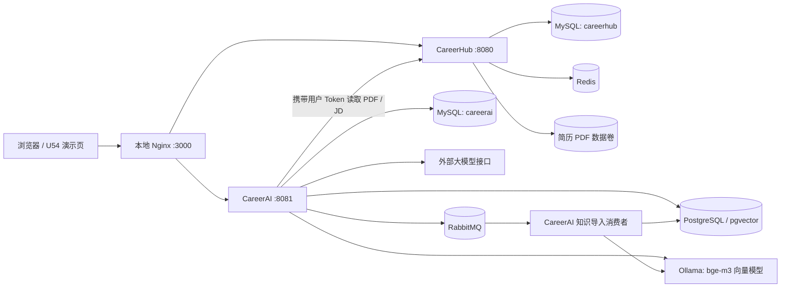
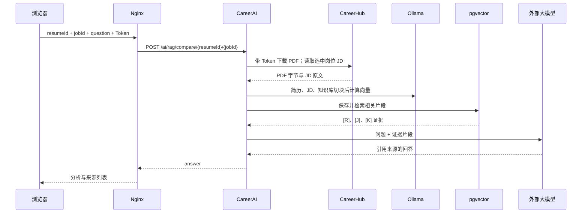

# CareerHub + CareerAI 架构与边界

本图对应当前本机 Docker Compose 版本。CareerHub 负责账号、岗位和 PDF 简历；CareerAI 负责模型分析、RAG 检索、Agent 工作流和异步知识导入。两个服务通过 HTTP 协作，分别运行。

## 指定岗位 RAG 对比

检索时简历与岗位 JD 各自必须有相关片段；知识库只能提供通用建议，不能替代简历经历或补写 JD 要求。当前实现每次请求都会重建上述文档向量，属于已知性能限制。

## 其他两条独立流程

- Agent 岗位分析：POST /ai/agent/skill-gap 接收 resumeId 和 goal；模型提出搜索或读取动作，Java 校验次数与岗位范围，最终返回结构化报告。它不接收指定 jobId，也不走上述 RAG 检索链路。
- 异步知识导入：上传接口保存原文件与任务记录，向 RabbitMQ 发布任务；CareerAI 消费者提取文本、切块、调用 Ollama 生成向量、写入 pgvector，任务状态供后续查询。RabbitMQ 不负责计算向量。

## 当前部署状态

Compose 已在本机启动核心服务，指定岗位 RAG 在 WSL 内使用虚构简历和 JD 完成一次端到端测试。U54 演示页面的 Nginx 容器与浏览器完整链路仍待验证。公网服务、生产监控和自动化发布尚未完成；本架构图不表示已对外上线。
